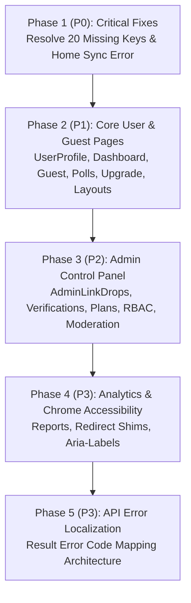

# CommunityLink Solution-Wide Localization Coverage Audit

> **Audit Type:** Full Solution Read-Only Localization Coverage & Resource Integrity Audit  
> **Date:** October 2026  
> **Target Framework:** .NET 10 / ASP.NET Core Blazor Interactive Server  
> **Primary Resources:** `CommunityLink.App/Resources/AppResources.resx` & `AppResources.my.resx`  
> **Supported Cultures:** English (`en`, `en-US`), Myanmar Unicode (`my`, `my-MM`)

---

## 1. Executive Summary

A comprehensive, read-only architectural audit was conducted across the entire **CommunityLink** repository (`CommunityLink.App`, `CommunityLink.Api`, and `CommunityLink.Domain`) to establish the exact localization status of all routable pages, shared layouts, navigation menus, reusable modals, and server-generated messages.

### A. Solution File Inventory & Classification Summary

| Component Category | Total Files | Fully Localized | Partially Localized | Not Localized | Needs Manual Verification | Not Applicable |
| :--- | :---: | :---: | :---: | :---: | :---: | :---: |
| **Routable Razor Pages** | 39 | 14 (35.9%) | 10 (25.6%) | 14 (35.9%) | 0 (0.0%) | 1 (2.6%) |
| **Shared Layouts & Chrome** | 8 | 2 (25.0%) | 4 (50.0%) | 0 (0.0%) | 0 (0.0%) | 2 (25.0%) |
| **Shared Modals & UI Components** | 20 | 12 (60.0%) | 5 (25.0%) | 0 (0.0%) | 0 (0.0%) | 3 (15.0%) |
| **Infrastructure / Core Shell** | 3 | 1 (33.3%) | 0 (0.0%) | 0 (0.0%) | 0 (0.0%) | 2 (66.7%) |
| **Backend API Controllers** | 16 | 0 (0.0%) | 0 (0.0%) | 16 (100.0%) | 0 (0.0%) | 0 (0.0%) |
| **Total Artifacts Audited** | **86** | **29 (33.7%)** | **19 (22.1%)** | **30 (34.9%)** | **0 (0.0%)** | **8 (9.3%)** |

### B. Current Resource Metrics (`AppResources.resx` vs `AppResources.my.resx`)

- **Total Registered Keys in `AppResources.resx` (EN):** 1,904 keys
- **Total Registered Keys in `AppResources.my.resx` (MY):** 1,904 keys
- **Key Parity:** **100.0%** (0 keys missing in EN, 0 keys missing in MY)
- **Empty / Null Values:** **0** (All 1,904 keys in both resources contain non-empty string values)
- **Format Placeholder Symmetry (`{0}`, `{1}`, etc.):** **100.0%** (0 placeholder mismatches detected)
- **Zawgyi Encoding / Non-Standard PUA Detection:** **0 occurrences** (100% compliant with standard Unicode Myanmar `U+1000..U+109F`)
- **Missing Referenced Keys in Code (`Loc["..."]` not found in `.resx`):** **20 distinct keys** across 5 files
- **Orphaned / Unreferenced Keys in `.resx`:** **29 keys** (candidate unused or legacy keys)
- **Estimated Remaining Unlocalized UI Strings (Frontend):** **~720+ strings** (~652 strings across 14 unlocalized pages + ~70 strings in partially localized files/layouts)

---

## 2. Existing Localization Mechanism

### Architecture Overview

1. **Service Registration:**  
   In `CommunityLink.App/Program.cs`:
   - `builder.Services.AddLocalization(options => options.ResourcesPath = "Resources");`
   - Request localization is configured for supported cultures: `en`, `my`, `en-US`, `my-MM`, defaulting to `en`.
   - `app.UseRequestLocalization(localizationOptions);` is hooked into the middleware pipeline.
   - Dynamic culture switching is implemented via minimal API endpoint `/culture/set?culture={code}&returnUrl={url}`, which writes the standard `.AspNetCore.Culture` cookie and redirects back.

2. **Client-Side HTML Root:**  
   In `CommunityLink.App/Components/App.razor`:
   - Inspects `CultureInfo.CurrentUICulture.TwoLetterISOLanguageName` and dynamically injects `<html lang="my">` or `<html lang="en">`, enabling proper font selection and CSS hyphenation/styling.

3. **Client-Side Dependency Injection:**  
   In localized Razor components:
   - `@inject IStringLocalizer<AppResources> Loc` is used across markup and C# `@code` blocks.
   - Text is resolved via `@Loc["Resource_Key"]` or `string.Format(CultureInfo.CurrentUICulture, Loc["Resource_Key"], arg)`.

4. **API Request Language Propagation:**  
   In `CommunityLink.App/Services/AcceptLanguageHeaderHandler.cs`:
   - A custom `DelegatingHandler` extracts `CultureInfo.CurrentUICulture` and appends `Accept-Language: my` or `Accept-Language: en` to outgoing HTTP requests without mutating shared headers.

5. **API Localization State:**  
   In `CommunityLink.Api/Program.cs`:
   - `builder.Services.AddLocalization()` and `app.UseRequestLocalization(...)` are registered.
   - **However, zero `.resx` resource files exist in `CommunityLink.Api` or `CommunityLink.Domain`.** Neither the API controllers nor domain services inject `IStringLocalizer`. Consequently, all server-generated status messages, validation failures, and exception summaries returned in `Result<T>` are hardcoded in English.

---

## 3. Complete Page Inventory Table (39 Routable Pages)

The following table catalogs all 39 routable Blazor pages across the solution, their exact route bindings, localization status, evidence, remaining work, and remediation priority.

| Page Component | Route(s) | Status | Evidence & Metrics | Remaining Work | Priority |
| :--- | :--- | :--- | :--- | :--- | :---: |
| [`AccessDenied.razor`](file:///D:/CommunityLink/CommunityLink.App/Components/Pages/AccessDenied.razor) | `/access-denied` | **Fully localized** | 4 Loc keys used; 0 hardcoded strings; page title, heading, desc, and action fully localized. | None. | Done |
| [`Activity.razor`](file:///D:/CommunityLink/CommunityLink.App/Components/Pages/Activity.razor) | `/activity` | **Not localized** | 419 lines; 0 Loc keys; 0 localizer injection. | Inject `Loc`, extract ~22 UI strings (page title, event filters, activity cards, timestamp labels, delete confirmation modal). | P2 |
| [`AdminAccounts.razor`](file:///D:/CommunityLink/CommunityLink.App/Components/Pages/Admin/AdminAccounts.razor) | `/admin/accounts` | **Fully localized** | 44 Loc keys used; 0 missing keys; search placeholder, table columns, modal, actions, and toasts localized. | None. Role codes (`ADMIN`, `SYSTEMADMIN`) are technical constants. | Done |
| [`AdminAuditLogs.razor`](file:///D:/CommunityLink/CommunityLink.App/Components/Pages/Admin/AdminAuditLogs.razor) | `/admin/audits` | **Fully localized** | 20 Loc keys used; 0 missing keys; filter controls, table headers, status badges, and loading states localized. | None. | Done |
| [`AdminCommunities.razor`](file:///D:/CommunityLink/CommunityLink.App/Components/Pages/Admin/AdminCommunities.razor) | `/admin/communities` | **Partially localized** | 24 Loc keys used; **1 missing key** (`Admin_Mod_ActionApprove` on L87). | Fix missing key reference on L87 (`Admin_Mod_ActionApprove` -> add to resx or alias). | P0 |
| [`AdminContentModeration.razor`](file:///D:/CommunityLink/CommunityLink.App/Components/Pages/Admin/AdminContentModeration.razor) | `/admin/content-moderation`, `/admin/content` | **Partially localized** | 35 Loc keys used; 3 hardcoded search/decision placeholders; 6 hardcoded action tooltips; hardcoded status badges (`Active`, `Private Mode`, `Inactive (Posting Locked)`). | Localize search placeholders, decision textarea placeholder, action tooltips, and status badges. | P2 |
| [`AdminDashboard.razor`](file:///D:/CommunityLink/CommunityLink.App/Components/Pages/AdminDashboard.razor) | `/admin`, `/admin/dashboard` | **Fully localized** | 51 Loc keys used; 0 missing keys; metrics cards, join request moderation, reports shortcuts, toasts localized. | None. | Done |
| [`AdminFinance.razor`](file:///D:/CommunityLink/CommunityLink.App/Components/Pages/Admin/AdminFinance.razor) | `/admin/finance` | **Partially localized** | 97 Loc keys used; 0 missing keys; **4 hardcoded pagination button titles** (`First Page`, `Previous Page`, `Next Page`, `Last Page`). | Localize pagination navigation button titles. | P2 |
| [`AdminLinkDrops.razor`](file:///D:/CommunityLink/CommunityLink.App/Components/Pages/Admin/AdminLinkDrops.razor) | `/admin/linkdrops`, `/admin/link-drops` | **Not localized** | 1,076 lines; 0 Loc keys; package creation modal, payment verification review, transaction ledger, and action toasts unlocalized (~121 strings). | Inject `Loc`, extract ~121 UI strings into resx, localize review tables and approval modals. | P2 |
| [`AdminLogin.razor`](file:///D:/CommunityLink/CommunityLink.App/Components/Pages/Admin/AdminLogin.razor) | `/admin/portal-entry/login` | **Fully localized** | 16 Loc keys used; 0 missing keys; header, inputs, submit button, error messages localized. | None. Password dot placeholder is culture-invariant. | Done |
| [`AdminPayoutManagement.razor`](file:///D:/CommunityLink/CommunityLink.App/Components/Pages/Admin/AdminPayoutManagement.razor) | `/admin/payouts` | **Fully localized** | 45 Loc keys used; 0 missing keys; filter tabs, payout request tables, approve/reject modals, toasts localized. | None. | Done |
| [`AdminPlans.razor`](file:///D:/CommunityLink/CommunityLink.App/Components/Pages/Admin/AdminPlans.razor) | `/admin/plans` | **Not localized** | 483 lines; 0 Loc keys; plan catalog, feature entitlements, pricing modals, and status toggle toasts unlocalized (~40 strings). | Inject `Loc`, extract ~40 UI strings into resx, localize plan cards and edit dialogs. | P2 |
| [`AdminRegister.razor`](file:///D:/CommunityLink/CommunityLink.App/Components/Pages/Admin/AdminRegister.razor) | `/admin/portal-entry/register` | **Not applicable** | 11 lines; 0 UI markup. Contains only an immediate C# navigation redirect to `/admin/portal-entry/login`. | None (architectural redirect shim). | N/A |
| [`AdminSettings.razor`](file:///D:/CommunityLink/CommunityLink.App/Components/Pages/Admin/AdminSettings.razor) | `/admin/settings` | **Fully localized** | 20 Loc keys used; 0 missing keys; system settings form, toggle switches, and feedback toasts localized. | None. | Done |
| [`AdminSetupPassword.razor`](file:///D:/CommunityLink/CommunityLink.App/Components/Pages/Admin/AdminSetupPassword.razor) | `/admin/portal-entry/setup-password` | **Fully localized** | 25 Loc keys used; 0 missing keys; operator invite setup form, validation messages, and feedback toasts localized. | None. | Done |
| [`AdminUsers.razor`](file:///D:/CommunityLink/CommunityLink.App/Components/Pages/Admin/AdminUsers.razor) | `/admin/users` | **Fully localized** | 67 Loc keys used; 0 missing keys; search, filter dropdowns, user status actions, role assignments, toasts localized. | None. | Done |
| [`AdminVerifications.razor`](file:///D:/CommunityLink/CommunityLink.App/Components/Pages/Admin/AdminVerifications.razor) | `/admin/verifications` | **Not localized** | 481 lines; 0 Loc keys; KYC identity audit queue, government ID inspector, review actions, and rejection note modals unlocalized (~45 strings). | Inject `Loc`, extract ~45 UI strings into resx, localize audit viewer and decision modals. | P2 |
| [`Chat.razor`](file:///D:/CommunityLink/CommunityLink.App/Components/Pages/Chat.razor) | `/chat` | **Partially localized** | 97 Loc keys used; **1 missing key reference** (`Chat_MemberPlural` on L2143 instead of `Chat_MembersPlural`); otherwise all message actions, reaction pickers, and modals localized. | Fix typo on L2143 to reference `Chat_MembersPlural`. | P0 |
| [`ChatRedirects.razor`](file:///D:/CommunityLink/CommunityLink.App/Components/Pages/ChatRedirects.razor) | `/chat-groups`, `/chat-groups/{chatGroupId:int?}`, `/chat-groups-directory` | **Not localized** | 23 lines; legacy route redirect shim; contains 1 visible loading label: `Opening Chat…` (L11). | Localize loading spinner label `Opening Chat…`. | P3 |
| [`Communities.razor`](file:///D:/CommunityLink/CommunityLink.App/Components/Pages/Communities.razor) | `/communities`, `/community` | **Partially localized** | 107 Loc keys used; 0 missing keys; **hardcoded `aria-label="Breadcrumbs"`** (L37); example URL placeholder. | Replace hardcoded breadcrumb aria-label with localized resource. | P1 |
| [`CommunityReport.razor`](file:///D:/CommunityLink/CommunityLink.App/Components/Pages/Report/CommunityReport.razor) | `/reports/communities` | **Not localized** | 174 lines; 0 Loc keys; community hierarchy report, member counts, group summaries unlocalized (~12 strings). | Inject `Loc`, extract ~12 strings for report headings, metrics labels, and print/export controls. | P3 |
| [`CreatorEarnings.razor`](file:///D:/CommunityLink/CommunityLink.App/Components/Pages/Creator/CreatorEarnings.razor) | `/creator/earnings` | **Fully localized** | 58 Loc keys used; 0 missing keys; earnings ledger, revenue metrics, commission summaries, and date filters localized. | None. Currency code `LD` is culture-invariant. | Done |
| [`CreatorPayouts.razor`](file:///D:/CommunityLink/CommunityLink.App/Components/Pages/Creator/CreatorPayouts.razor) | `/creator/payouts` | **Fully localized** | 60 Loc keys used; 0 missing keys; payout request form, payment method selector, withdrawal history localized. | None. Payment provider names (KBZPay, WavePay, etc.) are brand entities. | Done |
| [`GroupDetail.razor`](file:///D:/CommunityLink/CommunityLink.App/Components/Pages/GroupDetail.razor) | `/group/{groupId:int}` | **Partially localized** | 242 Loc keys used; **2 missing keys** (`GroupDetail_Btn_JoinGroup` on L932, `GroupDetail_Toast_DeletePollFailed` on L2406). | Fix L932 key reference to `GroupDetail_Action_JoinGroup`; add `GroupDetail_Toast_DeletePollFailed` to resx. | P0 |
| [`Groups.razor`](file:///D:/CommunityLink/CommunityLink.App/Components/Pages/Groups.razor) | `/groups` | **Partially localized** | 106 Loc keys used; 0 missing keys; **hardcoded `aria-label="Breadcrumbs"`** (L22). | Replace hardcoded breadcrumb aria-label with localized resource. | P1 |
| [`Guest.razor`](file:///D:/CommunityLink/CommunityLink.App/Components/Pages/Guest.razor) | `/guest`, `/welcome` | **Not localized** | 295 lines; 0 Loc keys; landing page hero, feature highlights, live consensus demo, encrypted messaging teaser unlocalized (~55 strings). | Inject `Loc`, extract ~55 marketing and institutional feature showcase strings. | P1 |
| [`Home.razor`](file:///D:/CommunityLink/CommunityLink.App/Components/Pages/Home.razor) | `/`, `/home` | **Partially localized** | 261 Loc calls (247 distinct keys); **8 missing keys** (`Home_Feed_Private`, `Home_Feed_Public`, `PostUpload_Post_BannedViewReason`, `PostUpload_Post_MenuEdit`, `PostUpload_Post_MenuMakePrivate`, `PostUpload_Post_MenuMakePublic`, `PostUpload_Post_MenuRecycle`, `PostUpload_Post_MenuReport`); **hardcoded loading card** (`Synchronizing Workspace`, `Loading ecosystem feeds...` on L740-741); `<PageTitle>` (L22). | Add/correct the 8 missing keys; replace hardcoded workspace loading card with localized strings; localize page title. | P0 |
| [`InviteJoin.razor`](file:///D:/CommunityLink/CommunityLink.App/Components/Pages/InviteJoin.razor) | `/invite/{Token}` | **Not localized** | 396 lines; 0 Loc keys; invite link verification, group preview card, expired/invalid link screens, fee acceptance, join actions unlocalized (~9 strings). | Inject `Loc`, extract ~9 UI strings for invite status, fee confirmation, and error screens. | P1 |
| [`LinkDrops.razor`](file:///D:/CommunityLink/CommunityLink.App/Components/Pages/LinkDrops.razor) | `/link-drops`, `/linkdrops` | **Fully localized** | 115 Loc keys used; 0 missing keys; package purchase grid, payment proof upload, wallet transaction history, toasts localized. | None. | Done |
| [`Polls.razor`](file:///D:/CommunityLink/CommunityLink.App/Components/Pages/Polls.razor) | `/polls` | **Not localized** | 889 lines; 0 Loc keys; stand-alone public polls explorer, ballot voting, vote counts, percentage bars, filter tabs unlocalized (~50 strings). | Inject `Loc`, extract ~50 strings for poll browsing, voting feedback, and empty states. | P1 |
| [`PostUpload.razor`](file:///D:/CommunityLink/CommunityLink.App/Components/Pages/PostUpload.razor) | `/feed`, `/postupload` | **Fully localized** | 98 Loc keys used; 0 missing keys; post composer, code snippet editor, attachment upload, privacy toggle, feed tabs, toasts localized. | None. Fallback attachment filenames (`attached.txt`) are technical identifiers. | Done |
| [`RolePermissions.razor`](file:///D:/CommunityLink/CommunityLink.App/Components/Pages/RolePermissions.razor) | `/admin/rbac`, `/admin/roles` | **Not localized** | 625 lines; 0 Loc keys; RBAC management matrix, role creation modal, permission toggle checkboxes, confirmation dialogs unlocalized (~45 strings). | Inject `Loc`, extract ~45 strings for RBAC controls and confirmation modals. | P2 |
| [`SubCommunities.razor`](file:///D:/CommunityLink/CommunityLink.App/Components/Pages/SubCommunities.razor) | `/sub-communities`, `/sub-communities/{ParentCommunityId:int}`, `/community/{ParentCommunityId:int}/sub-communities`, `/communities/{ParentCommunityId:int}/sub-communities` | **Partially localized** | 90 Loc keys used; 0 missing keys; **hardcoded `aria-label="Breadcrumbs"`** (L21); example URL placeholder. | Replace hardcoded breadcrumb aria-label with localized resource. | P1 |
| [`Upgrade.razor`](file:///D:/CommunityLink/CommunityLink.App/Components/Pages/Upgrade.razor) | `/upgrade`, `/membership` | **Not localized** | 786 lines; 0 Loc keys; tier comparison cards, KYC verification form (government ID upload, legal name), application status tracker unlocalized (~86 strings). | Inject `Loc`, extract ~86 strings for upgrade tiers, document requirements, and verification submission. | P1 |
| [`UserDashboard.razor`](file:///D:/CommunityLink/CommunityLink.App/Components/Pages/UserDashboard.razor) | `/user/dashboard`, `/dashboard` | **Not localized** | 270 lines; 0 Loc keys; user profile summary, earnings snapshot, active groups rail, recent activity stream unlocalized (~21 strings). | Inject `Loc`, extract ~21 strings for dashboard summary cards and shortcut links. | P1 |
| [`UserLogin.razor`](file:///D:/CommunityLink/CommunityLink.App/Components/Pages/Account/UserLogin.razor) | `/login` | **Fully localized** | 16 Loc keys used; 0 missing keys; form labels, placeholders, forgot password button, validation errors localized. | None. Password dot placeholder is culture-invariant. | Done |
| [`UserProfile.razor`](file:///D:/CommunityLink/CommunityLink.App/Components/Pages/UserProfile.razor) | `/profile`, `/u/{UserNameOrId}` | **Not localized** | 3,089 lines; 0 Loc keys; profile header, edit bio modal, post stream, social tabs, followers rail, private chat unlock, toasts unlocalized (~133 strings). | Inject `Loc`, extract ~133 strings across profile header, edit modals, tab headers, and post interactions. | P1 |
| [`UserRegister.razor`](file:///D:/CommunityLink/CommunityLink.App/Components/Pages/Account/UserRegister.razor) | `/register` | **Fully localized** | 20 Loc keys used; 0 missing keys; form inputs, validation messages, terms confirmation, submit button localized. | None. Sample names ("Jane Doe") in placeholders are sample data. | Done |
| [`UserReport.razor`](file:///D:/CommunityLink/CommunityLink.App/Components/Pages/Report/UserReport.razor) | `/reports/users` | **Not localized** | 326 lines; 0 Loc keys; user popularity rankings, top content metrics, export options unlocalized (~12 strings). | Inject `Loc`, extract ~12 strings for report headings, metrics labels, and table columns. | P3 |

---

## 4. Shared Layouts, Navigation, and Modals Inventory

### A. Shared Layouts & Chrome (8 Components)

| Layout Component | Classification | Evidence & Key Usages | Remaining Work |
| :--- | :--- | :--- | :--- |
| [`AdminLayout.razor`](file:///D:/CommunityLink/CommunityLink.App/Components/Layout/AdminLayout.razor) | **Fully localized** | Injects `Loc`; all navigation links, sidebar headers, theme toggle, change password modal triggers use `Loc[...]`. | None. |
| [`AuthLayout.razor`](file:///D:/CommunityLink/CommunityLink.App/Components/Layout/AuthLayout.razor) | **Not applicable** | Minimal HTML layout container rendering only `@Body`. Contains 0 user-facing text strings. | None. |
| [`LandingLayout.razor`](file:///D:/CommunityLink/CommunityLink.App/Components/Layout/LandingLayout.razor) | **Partially localized** | Contains hardcoded English `#blazor-error-ui`: `An unhandled error has occurred. <a class="reload">Reload</a>`. | Replace error markup with localized resources matching `MainLayout`. |
| [`LinkDropNavbarBalance.razor`](file:///D:/CommunityLink/CommunityLink.App/Components/Layout/LinkDropNavbarBalance.razor) | **Fully localized** | Injects `Loc`; tooltip uses `Loc["LinkDrop_BalanceTooltip"]`, `LinkDrop_LoadingBalance`, `LinkDrop_WalletUnavailable` with `CultureInfo.CurrentUICulture`. | None. |
| [`MainLayout.razor`](file:///D:/CommunityLink/CommunityLink.App/Components/Layout/MainLayout.razor) | **Partially localized** | Injects `Loc` (used for search placeholder, nav buttons, profile menu). **Hardcoded elements:** (1) Close Account modal markup (L247-280: `Delete Account`, `Are you sure...`, `Warning:`, `Cancel`, `Yes, Delete My Account`); (2) Sidebar toggle `title="Toggle navigation sidebar" aria-label="Toggle navigation sidebar"` (L47); (3) C# role label fallbacks (L350-357: `Administrator`, `Default User`, `Community Member`, etc.). | Localize Close Account modal, sidebar toggle aria-labels, and C# role fallback strings. |
| [`NavMenu.razor`](file:///D:/CommunityLink/CommunityLink.App/Components/Layout/NavMenu.razor) | **Partially localized** | Injects `Loc`; navigation links use `Nav_*` keys. **Hardcoded elements:** (1) L17 `title="Close sidebar" aria-label="Close sidebar"`; (2) L97 `title="Verified Member"`. | Localize sidebar close button title/aria-label and verified member badge tooltip. |
| [`NotificationBell.razor`](file:///D:/CommunityLink/CommunityLink.App/Components/Layout/NotificationBell.razor) | **Partially localized** | Injects `Loc`; bell panel title, empty state, mark all as read use `Notifications_*` keys. **Hardcoded elements:** `FormatTimeAgo` method (L135-143) returns hardcoded English strings: `"Just now"`, `"15m ago"`, `"2h ago"`, `"3d ago"`. | Localize `FormatTimeAgo` using existing `Home_Feed_Time*` or dedicated notification relative-time keys. |
| [`ToastContainer.razor`](file:///D:/CommunityLink/CommunityLink.App/Components/Layout/ToastContainer.razor) | **Not applicable** | Presentation container for toasts emitted by `ToastService`. Contains 0 embedded text strings. | None (toast message strings are localized at invocation site). |

### B. Shared Modals & UI Components (20 Components)

| Component | Classification | Evidence & Key Usages | Remaining Work |
| :--- | :--- | :--- | :--- |
| [`AuthSplitScreen.razor`](file:///D:/CommunityLink/CommunityLink.App/Components/Shared/AuthSplitScreen.razor) | **Fully localized** | Injects `Loc`; protocol badges, security indicators, member feature bullet lists, admin feature bullet lists all localized. | None. |
| [`ChangePasswordModal.razor`](file:///D:/CommunityLink/CommunityLink.App/Components/Shared/ChangePasswordModal.razor) | **Partially localized** | Injects `Loc`; titles, inputs, hints, validation rules, feedback toasts all localized. **Hardcoded:** L24 `aria-label="Close"`. | Localize modal close button `aria-label`. |
| [`EyeIcon.razor`](file:///D:/CommunityLink/CommunityLink.App/Components/Shared/EyeIcon.razor) | **Not applicable** | SVG password toggle icon with `aria-hidden="true"`. Contains 0 user-facing text strings. | None. |
| [`ForgotPasswordModal.razor`](file:///D:/CommunityLink/CommunityLink.App/Components/Shared/ForgotPasswordModal.razor) | **Partially localized** | Injects `Loc`; 3-step reset wizard, OTP inputs, validation errors, success messages all localized. **Hardcoded:** L24 `aria-label="Close"`, L86 `aria-label="Enter the 6-digit verification code"`. | Localize close button and OTP input aria-labels. |
| [`LanguageSelector.razor`](file:///D:/CommunityLink/CommunityLink.App/Components/Shared/LanguageSelector.razor) | **Partially localized** | Culture switcher toggle component. **Hardcoded:** `aria-label="Language selection"`, `aria-label="Switch language to English"`. | Localize navigation aria-labels. |
| [`LinkDrop3dIcon.razor`](file:///D:/CommunityLink/CommunityLink.App/Components/Shared/LinkDrop3dIcon.razor) | **Not applicable** | Three.js WebGL / SVG 3D canvas icon with `aria-hidden="true"`. | None. |
| [`LinkDropIcon.razor`](file:///D:/CommunityLink/CommunityLink.App/Components/Shared/LinkDropIcon.razor) | **Not applicable** | Raw SVG vector graphic icon with `aria-hidden="true"`. | None. |
| [`PaidChatSettingsModal.razor`](file:///D:/CommunityLink/CommunityLink.App/Components/Shared/PaidChatSettingsModal.razor) | **Fully localized** | Injects `Loc`; fee inputs, toggle switches, hints, save button, and toasts fully localized. | None. |
| [`TelemetryChart.razor`](file:///D:/CommunityLink/CommunityLink.App/Components/Shared/TelemetryChart.razor) | **Fully localized** | Injects `Loc`; localized fallbacks for titles/series (`TelemetryChart_Default*`); SVG coordinates formatted with `CultureInfo.InvariantCulture`. | None. |
| [`ChatMessageBubble.razor`](file:///D:/CommunityLink/CommunityLink.App/Components/Shared/Chat/ChatMessageBubble.razor) | **Fully localized** | 21 Loc keys used; pinned labels, edited badges, read receipts, media tooltips, reaction indicators fully localized. | None. |
| [`ChatMessageComposer.razor`](file:///D:/CommunityLink/CommunityLink.App/Components/Shared/Chat/ChatMessageComposer.razor) | **Fully localized** | 17 Loc keys used; input placeholder, attachment popovers, voice memo tooltip, send action fully localized. | None. |
| [`ChatMessageList.razor`](file:///D:/CommunityLink/CommunityLink.App/Components/Shared/Chat/ChatMessageList.razor) | **Fully localized** | 4 Loc keys used; loading spinner, date separator grouping, empty conversation state fully localized. | None. |
| [`ChatModal.razor`](file:///D:/CommunityLink/CommunityLink.App/Components/Shared/Chat/ChatModal.razor) | **Partially localized** | Dialog shell. **Hardcoded:** L28 `aria-label="Close dialog"`. | Localize close button `aria-label`. |
| [`ChatThreadHeader.razor`](file:///D:/CommunityLink/CommunityLink.App/Components/Shared/Chat/ChatThreadHeader.razor) | **Fully localized** | 15 Loc keys used; presence status ("online", "offline"), group info trigger, call buttons fully localized. | None. |
| [`ChatThreadInfoPanel.razor`](file:///D:/CommunityLink/CommunityLink.App/Components/Shared/Chat/ChatThreadInfoPanel.razor) | **Partially localized** | 167 Loc calls; **8 missing resource keys:** `Common_Back`, `Chat_Loading`, `Common_LoadMore`, `Common_Saving`, `Chat_Close`, `Chat_Muted`, `Chat_Deleting`, `Chat_Leaving`. | Map keys to existing equivalents (`Common_Close`, etc.) and add missing keys to resx. |
| [`ChatThreadList.razor`](file:///D:/CommunityLink/CommunityLink.App/Components/Shared/Chat/ChatThreadList.razor) | **Fully localized** | 24 Loc keys used; conversation filters, search input, unread counters, empty thread states fully localized. | None. |
| [`DiscoverGroupsDrawer.razor`](file:///D:/CommunityLink/CommunityLink.App/Components/Shared/Chat/DiscoverGroupsDrawer.razor) | **Fully localized** | 12 Loc keys used; drawer title, search input, join actions, fee badges fully localized. | None. |
| [`UnlockChatModal.razor`](file:///D:/CommunityLink/CommunityLink.App/Components/Shared/Chat/UnlockChatModal.razor) | **Fully localized** | 8 Loc keys used; fee confirmation, balance check, unlock button, toasts fully localized. | None. |
| [`CreateChatGroupModal.razor`](file:///D:/CommunityLink/CommunityLink.App/Components/Pages/CreateChatGroupModal.razor) | **Fully localized** | Group name, description, privacy mode, fee inputs, file upload, error validations fully localized. `placeholder="e.g. 50"` is numeric sample. | None. |
| [`ReportContentModal.razor`](file:///D:/CommunityLink/CommunityLink.App/Components/Pages/ReportContentModal.razor) | **Fully localized** | Violation categories, details textarea, submit action, and feedback toasts fully localized. | None. |

### C. Infrastructure & Routing (3 Files)

| File | Classification | Status & Notes |
| :--- | :--- | :--- |
| [`App.razor`](file:///D:/CommunityLink/CommunityLink.App/Components/App.razor) | **Fully localized** | Inspects `CultureInfo.CurrentUICulture` and dynamically renders `<html lang="en">` or `<html lang="my">`. |
| [`Routes.razor`](file:///D:/CommunityLink/CommunityLink.App/Components/Routes.razor) | **Not applicable** | Pure Blazor router setup with default layout definition. Zero text content. |
| [`_Imports.razor`](file:///D:/CommunityLink/CommunityLink.App/Components/_Imports.razor) | **Not applicable** | Global namespace imports including `Microsoft.Extensions.Localization`. |

---

## 5. Unlocalized Strings & Missing Keys Detailed Breakdown

### A. Missing Keys Referenced in Code (`Loc["..."]` Without Resx Entry)

Static scanning of all `Loc["..."]` invocations identified **20 distinct missing keys** referenced across 5 files:

1. **`Home.razor` (8 missing keys):**
   - `@Loc["PostUpload_Post_MenuReport"]` (L957) &rarr; *Fix: Replace with existing key `PostUpload_Post_Report`*
   - `@Loc["PostUpload_Post_MenuMakePublic"]` (L965) &rarr; *Fix: Replace with existing key `PostUpload_Post_MakePublic`*
   - `@Loc["PostUpload_Post_MenuMakePrivate"]` (L965) &rarr; *Fix: Replace with existing key `PostUpload_Post_MakePrivate`*
   - `@Loc["PostUpload_Post_MenuEdit"]` (L970) &rarr; *Fix: Replace with existing key `PostUpload_Post_Edit`*
   - `@Loc["PostUpload_Post_MenuRecycle"]` (L975) &rarr; *Fix: Replace with existing key `PostUpload_Post_Recycle`*
   - `@Loc["PostUpload_Post_BannedViewReason"]` (L936) &rarr; *Fix: Replace with existing key `PostUpload_Post_ViewReason`*
   - `@Loc["Home_Feed_Private"]` (L1812) &rarr; *Fix: Add to resx (`Private` / `သီးသန့်`)*
   - `@Loc["Home_Feed_Public"]` (L1812) &rarr; *Fix: Add to resx (`Public` / `အများပြည်သူ`)*

2. **`Chat.razor` (1 missing key):**
   - `@Loc["Chat_MemberPlural"]` (L2143) &rarr; *Fix: Change to existing key `Chat_MembersPlural` (typo omission of 's')*

3. **`GroupDetail.razor` (2 missing keys):**
   - `@Loc["GroupDetail_Btn_JoinGroup"]` (L932) &rarr; *Fix: Replace with existing key `GroupDetail_Action_JoinGroup`*
   - `@Loc["GroupDetail_Toast_DeletePollFailed"]` (L2406) &rarr; *Fix: Add key to `AppResources.resx` and `AppResources.my.resx`*

4. **`AdminCommunities.razor` (1 missing key):**
   - `@Loc["Admin_Mod_ActionApprove"]` (L87) &rarr; *Fix: Add key to resx (`Approve` / `အတည်ပြုသည်`)*

5. **`ChatThreadInfoPanel.razor` (8 missing keys):**
   - `@Loc["Chat_Close"]` (L575, L990) &rarr; *Fix: Replace with existing key `Common_Close`*
   - `@Loc["Common_Back"]` (L131) &rarr; *Fix: Add key to resx (`Back` / `နောက်သို့`)*
   - `@Loc["Chat_Loading"]` (L236, L607) &rarr; *Fix: Add key to resx (`Loading...` / `ရယူနေသည်...`)*
   - `@Loc["Common_LoadMore"]` (L236) &rarr; *Fix: Add key to resx (`Load more` / `ထပ်မံရယူရန်`)*
   - `@Loc["Common_Saving"]` (L293, L345, L393, L887) &rarr; *Fix: Add key to resx (`Saving...` / `သိမ်းဆည်းနေသည်...`)*
   - `@Loc["Chat_Muted"]` (L746) &rarr; *Fix: Add key to resx (`Muted` / `အသံပိတ်ထားသည်`)*
   - `@Loc["Chat_Deleting"]` (L1023, L1067) &rarr; *Fix: Add key to resx (`Deleting...` / `ဖျက်နေသည်...`)*
   - `@Loc["Chat_Leaving"]` (L1067) &rarr; *Fix: Add key to resx (`Leaving...` / `ထွက်ခွာနေသည်...`)*

### B. Hardcoded UI Strings in Partially Localized Pages & Layouts

1. **`MainLayout.razor`:**
   - L47: `title="Toggle navigation sidebar" aria-label="Toggle navigation sidebar"`
   - L257-276: Delete Account confirmation modal:
     - `Delete Account`
     - `Are you sure you want to delete your account ({0})?`
     - `Warning:`
     - `Deleting your account will log you out immediately. Your account and personal information will be deleted permanently.`
     - `Cancel`
     - `Yes, Delete My Account`
   - L350-357: C# fallback role labels:
     - `"ADMIN" => "Administrator"`
     - `"USER" => "Default User"`
     - `"MEMBER" => "Community Member"`
     - `"MODERATOR" => "Community Moderator"`
     - `"DOMAIN_PRO" => "Domain Professional"`
     - `"PUBLIC_FIGURE" => "Public Figure"`
     - `_ => "Guest"`

2. **`Home.razor`:**
   - L22: `<PageTitle>Ecosystem Home – CommunityLink</PageTitle>`
   - L740: `<h3 ...>Synchronizing Workspace</h3>`
   - L741: `<p ...>Loading ecosystem feeds, community channels, and updates...</p>`

3. **`NotificationBell.razor`:**
   - L135-143: `FormatTimeAgo`: `"Just now"`, `"{0}m ago"`, `"{0}h ago"`, `"{0}d ago"`

4. **`NavMenu.razor`:**
   - L17: `title="Close sidebar" aria-label="Close sidebar"`
   - L97: `title="Verified Member"`

5. **`AdminContentModeration.razor`:**
   - L83: `placeholder="Search groups by group name..."`
   - L104: `placeholder="Search posts & polls by author name or description/content..."`
   - L177: Status badge text: `Private Mode`
   - L301: Status badge text: `Active`
   - L308: Status badge text: `Inactive (Posting Locked)`
   - L341: `placeholder="Explain the decision or add context..."`
   - Action tooltips:
     - L258: `title="Make group inactive (disables new posts & polls, existing posts receive comments/likes)"`
     - L267: `title="Ban post - hidden from all except author & admin"`
     - L313: `title="Set group inactive: Disables new posts/polls, but preserves likes/comments/shares"`
     - L321: `title="Reactivate group to allow new posts and polls"`
     - L428: `title="Ban post - only admin and author will be able to see it"`
     - L435: `title="Unban post and restore full visibility"`

6. **`AdminFinance.razor`:**
   - Pagination button titles (L180-210): `title="First Page"`, `title="Previous Page"`, `title="Next Page"`, `title="Last Page"`

7. **`LandingLayout.razor`:**
   - L9-10: `An unhandled error has occurred.`, `Reload`

8. **Breadcrumb Accessibility Labels:**
   - `Communities.razor` (L37): `aria-label="Breadcrumbs"`
   - `Groups.razor` (L22): `aria-label="Breadcrumbs"`
   - `SubCommunities.razor` (L21): `aria-label="Breadcrumbs"`

---

## 6. Server-Side / API User-Facing Messages Audit

### A. API Architecture Inspection

1. **Endpoint Implementation:**  
   The backend API consists of 16 controllers across `CommunityLink.Api\Controllers` and `CommunityLink.Domain\Features`:
   - `AuthenticationController.cs`
   - `AdministrationController.cs`
   - `DashboardController.cs`
   - `PremiumUpgradeController.cs`
   - `ReportController.cs`
   - `SubscriptionPlansController.cs`
   - `UsersController.cs`
   - `VerificationAuditController.cs`
   - `CommunityController.cs`
   - `GroupController.cs`
   - `PostController.cs`
   - `PollController.cs`
   - `ChatController.cs`
   - `ChatGroupController.cs`
   - `CreatorEarningsController.cs`
   - `LinkDropPaymentController.cs`

2. **Localization Ingestion:**  
   - The frontend's `AcceptLanguageHeaderHandler` successfully passes `Accept-Language: my` or `Accept-Language: en` on all API calls.
   - `CommunityLink.Api/Program.cs` registers `app.UseRequestLocalization()`.
   - **However, neither `CommunityLink.Api` nor `CommunityLink.Domain` has any resource files (`.resx`) or `IStringLocalizer` references.**
   - All domain services return English strings via `Result.Failure("User not found")`, `Result.Failure("Invalid credentials")`, `Result.Failure("Insufficient balance")`, etc.

3. **Frontend Toast Vulnerability Pattern:**  
   Across multiple Blazor pages, toast messages are wired as:
   ```csharp
   Toast.Error(res.Message ?? Loc["Some_Fallback_Key"]);
   ```
   **Impact:** When the API fails with an error message, `res.Message` is not null. Therefore, the raw English message from the server overrides the localized fallback, presenting English error toasts to users even when Myanmar culture is selected.
   Furthermore, in catch blocks:
   ```csharp
   Toast.Error($"Failed to update post: {ex.Message}");
   ```
   Uncaught framework exceptions leak raw English runtime errors directly into the UI.

---

## 7. Resource Integrity Analysis

### A. Key Parity & Completeness
- **Total Keys:** 1,904 in `AppResources.resx` and 1,904 in `AppResources.my.resx`.
- **Bidirectional Parity:** 100.0%. No keys exist in EN that do not exist in MY, and vice-versa.
- **Empty Values:** Checked both XML structures. Exactly 0 keys contain null or whitespace values.

### B. Format Placeholder Symmetry
Every key in `AppResources.resx` and `AppResources.my.resx` was parsed for positional placeholders (`{0}`, `{1}`, `{2}`, etc.).
- **Total Placeholders Checked:** 187 parametrized strings.
- **Mismatches:** **0**. All placeholders in English match the corresponding placeholders in Myanmar identically in position and type.

### C. Unicode Compliance & Zawgyi Detection
A regex scan tested all 1,904 Myanmar values against:
- Private Use Area (PUA) ranges: `U+EA00..U+EFFF`, `U+E000..U+F8FF`
- Non-standard Zawgyi code points: `U+1060..U+1097` (when outside standard Unicode ordering)
- **Result:** **0 Zawgyi / PUA violations found**. The existing Myanmar resource file strictly adheres to the official Myanmar Unicode Standard (Unicode 15.0 / ISO/IEC 10646).

---

## 8. Prioritized Remediation Plan

To bring the CommunityLink platform to 100% localization coverage, the following phased plan is recommended:



### Phase 1: Critical Hotfixes & Missing Key Resolution (P0 — Immediate)
- **Objective:** Fix the 20 missing key references that currently cause raw key strings to render in the UI, and localize the workspace loading card in `Home.razor`.
- **Target Files:**
  - `Home.razor`: Wire `PostUpload_Post_Report`, `PostUpload_Post_MakePublic`, `PostUpload_Post_MakePrivate`, `PostUpload_Post_Edit`, `PostUpload_Post_Recycle`, `PostUpload_Post_ViewReason`; add `Home_Feed_Private` and `Home_Feed_Public`; localize `Synchronizing Workspace`.
  - `Chat.razor`: Fix typo `Chat_MemberPlural` &rarr; `Chat_MembersPlural`.
  - `GroupDetail.razor`: Fix typo `GroupDetail_Btn_JoinGroup` &rarr; `GroupDetail_Action_JoinGroup`; add `GroupDetail_Toast_DeletePollFailed`.
  - `AdminCommunities.razor`: Add `Admin_Mod_ActionApprove`.
  - `ChatThreadInfoPanel.razor`: Wire `Common_Close`; add `Common_Back`, `Chat_Loading`, `Common_LoadMore`, `Common_Saving`, `Chat_Muted`, `Chat_Deleting`, `Chat_Leaving`.
- **Estimated Effort:** ~2 hours | Low risk.

### Phase 2: Core User & Guest Experience (P1 — High Priority)
- **Objective:** Localize the primary user-facing touchpoints where unauthenticated visitors and logged-in members spend most of their time.
- **Target Files:**
  - [`UserProfile.razor`](file:///D:/CommunityLink/CommunityLink.App/Components/Pages/UserProfile.razor) (3,089 lines, ~133 strings: profile editing, social stats, tabs, post interactions).
  - [`UserDashboard.razor`](file:///D:/CommunityLink/CommunityLink.App/Components/Pages/UserDashboard.razor) (270 lines, ~21 strings: welcome card, stats, quick links).
  - [`Guest.razor`](file:///D:/CommunityLink/CommunityLink.App/Components/Pages/Guest.razor) (295 lines, ~55 strings: marketing hero, feature highlights, consensus showcase).
  - [`Polls.razor`](file:///D:/CommunityLink/CommunityLink.App/Components/Pages/Polls.razor) (889 lines, ~50 strings: public ballots explorer, voting submission, percentage results).
  - [`Upgrade.razor`](file:///D:/CommunityLink/CommunityLink.App/Components/Pages/Upgrade.razor) (786 lines, ~86 strings: subscription tiers, KYC document upload, verification progress).
  - [`InviteJoin.razor`](file:///D:/CommunityLink/CommunityLink.App/Components/Pages/InviteJoin.razor) (396 lines, ~9 strings: invitation token acceptance and error states).
  - [`MainLayout.razor`](file:///D:/CommunityLink/CommunityLink.App/Components/Layout/MainLayout.razor), [`NavMenu.razor`](file:///D:/CommunityLink/CommunityLink.App/Components/Layout/NavMenu.razor), [`NotificationBell.razor`](file:///D:/CommunityLink/CommunityLink.App/Components/Layout/NotificationBell.razor) (~20 strings: delete account modal, role fallbacks, relative time).
- **Estimated Effort:** 2–3 business days | Medium risk (high file volume).

### Phase 3: Administrative Control Panel & Moderation (P2 — Medium Priority)
- **Objective:** Complete localization across all administrative workflows.
- **Target Files:**
  - [`AdminLinkDrops.razor`](file:///D:/CommunityLink/CommunityLink.App/Components/Pages/Admin/AdminLinkDrops.razor) (1,076 lines, ~121 strings: package editor, payment verification approval).
  - [`AdminVerifications.razor`](file:///D:/CommunityLink/CommunityLink.App/Components/Pages/Admin/AdminVerifications.razor) (481 lines, ~45 strings: KYC identity audit queue).
  - [`RolePermissions.razor`](file:///D:/CommunityLink/CommunityLink.App/Components/Pages/RolePermissions.razor) (625 lines, ~45 strings: RBAC matrix and role creation).
  - [`AdminPlans.razor`](file:///D:/CommunityLink/CommunityLink.App/Components/Pages/Admin/AdminPlans.razor) (483 lines, ~40 strings: subscription plans).
  - [`Activity.razor`](file:///D:/CommunityLink/CommunityLink.App/Components/Pages/Activity.razor) (419 lines, ~22 strings: activity log explorer).
  - [`AdminContentModeration.razor`](file:///D:/CommunityLink/CommunityLink.App/Components/Pages/Admin/AdminContentModeration.razor) (remediate 3 placeholders, 6 titles, 3 badges).
  - [`AdminFinance.razor`](file:///D:/CommunityLink/CommunityLink.App/Components/Pages/Admin/AdminFinance.razor) (remediate 4 pagination titles).
- **Estimated Effort:** 2 business days | Low-to-medium risk.

### Phase 4: Reports, Chrome Accessibility & Shims (P3 — Polish)
- **Objective:** Final polish for reporting pages, accessibility attributes, and shims.
- **Target Files:**
  - [`CommunityReport.razor`](file:///D:/CommunityLink/CommunityLink.App/Components/Pages/Report/CommunityReport.razor) (~12 strings) & [`UserReport.razor`](file:///D:/CommunityLink/CommunityLink.App/Components/Pages/Report/UserReport.razor) (~12 strings).
  - [`ChatRedirects.razor`](file:///D:/CommunityLink/CommunityLink.App/Components/Pages/ChatRedirects.razor) (1 string: `Opening Chat…`).
  - [`LandingLayout.razor`](file:///D:/CommunityLink/CommunityLink.App/Components/Layout/LandingLayout.razor) (Blazor error UI).
  - Accessibility labels on [`LanguageSelector.razor`](file:///D:/CommunityLink/CommunityLink.App/Components/Shared/LanguageSelector.razor), [`ChatModal.razor`](file:///D:/CommunityLink/CommunityLink.App/Components/Shared/Chat/ChatModal.razor), [`ChangePasswordModal.razor`](file:///D:/CommunityLink/CommunityLink.App/Components/Shared/ChangePasswordModal.razor), [`ForgotPasswordModal.razor`](file:///D:/CommunityLink/CommunityLink.App/Components/Shared/ForgotPasswordModal.razor), and breadcrumb navigation.
- **Estimated Effort:** ~1 business day | Low risk.

### Phase 5: Server-Side API Localization Architecture (P3 — Architectural Enhancement)
- **Objective:** Prevent raw English API error strings from bleeding into localized UI toasts.
- **Recommendations:**
  1. Standardize backend `Result<T>` to return structured error codes (e.g. `ErrorCodes.UserNotFound`) alongside developer English messages.
  2. Implement client-side error code translation in `CommunityLink.App` that maps known API error codes directly to `Loc["ApiError_{Code}"]`.
  3. Where client mapping is not feasible, implement backend `.resx` resource lookup in `CommunityLink.Domain` utilizing the incoming `Accept-Language` header.
- **Estimated Effort:** 3 business days | Architectural scope.

---
*End of Report.*
